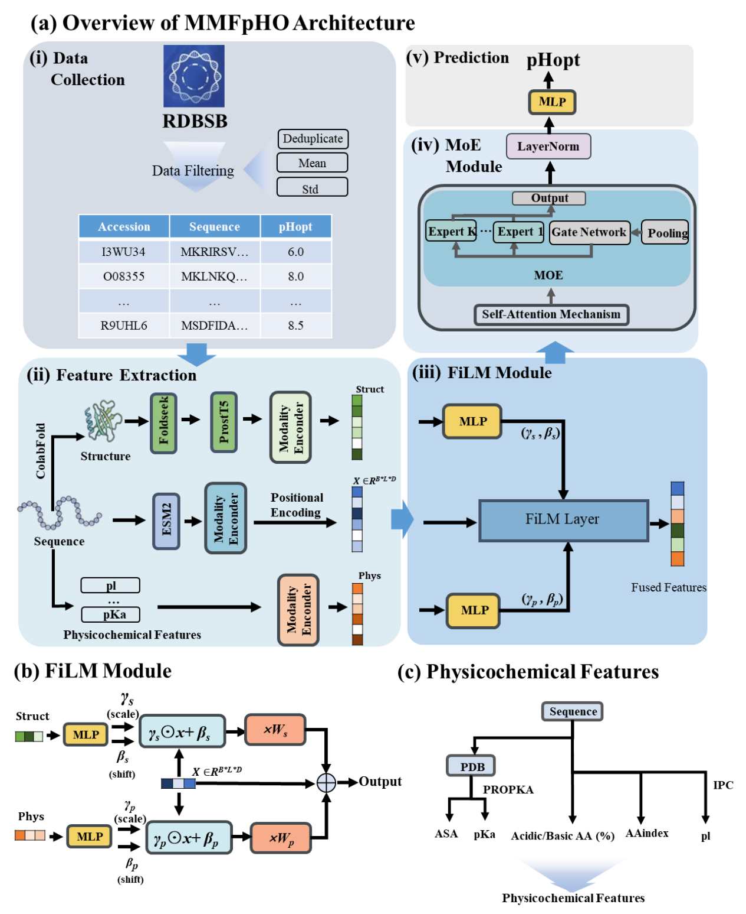

<div align="center">

# MMFpHO

**Mixture-of-Experts-Based Multi-Modal Fusion for Predicting Enzyme Optimal pH**

[](https://www.python.org/)
[](https://pytorch.org/)
[](#license)

</div>

## Introduction

MMFpHO predicts an enzyme's optimal pH directly from its amino-acid sequence. It fuses three complementary modalities:

- **Sequence** — residue-level ESM-2 embeddings.
- **Structure** — Foldseek 3Di + ProstT5 structural embeddings.
- **Physicochemical** — pI, acidic/basic composition, PROPKA-derived pKa, DSSP solvent accessibility, and AAindex descriptors.

The sequence representation is the backbone; structure and physicochemical features condition it in a shared 512-d space. A sparse **Mixture-of-Experts (MoE)** Transformer (6 experts, top-2 routing) refines the fused representation before regression.

The same framework also supports optimal temperature prediction (**MMFpHO-Topt**).

<p align="center">
  
</p>

<p align="center"><em>MMFpHO architecture: multi-modal feature extraction, conditional fusion, MoE refinement, and pH prediction.</em></p>

On the held-out pH test set, MMFpHO achieves **R² = 0.464**, **RMSE = 0.984**, **Pearson = 0.684**, **Spearman = 0.575**, and **AUC = 0.783**, outperforming Venus, Seq2pHopt, CatOpt, and EpHod. MMFpHO-Topt achieves **R² = 0.508** and **RMSE = 11.336** for optimal temperature prediction.

## Installation

```bash
git clone https://github.com/YannanBin/MMFpHO.git
cd MMFpHO

conda env create -f environment.yml
conda activate CLEF
```

`environment.yml` was exported with CUDA 12.1. If it does not match your GPU driver, install a compatible PyTorch build manually.

## Data

- `data/input_data/` — training/test CSVs and precomputed feature dictionaries.
- `data/models/` — pretrained `ph_predict.pt` and `topt_predict.pt` checkpoints.

The ESM-2 sequence embeddings are not included because of their size. Extract them with `code/feature_processed/esm2.py` and place the resulting pickle in `data/input_data/`.

> The research scripts contain absolute paths from the original compute environment (e.g. `/data5/heyuhang/...`). Update these paths at the top of the training/inference scripts before running.

## Usage

Train the optimal pH model:

```bash
python code/train_ph.py
```

Run inference:

```bash
python code/test_sigmod.py
```

Train the optimal temperature model:

```bash
python code/train_opt.py
```

## Pretrained models

| Checkpoint | Task |
|---|---|
| `data/models/ph_predict.pt` | Optimal pH |
| `data/models/topt_predict.pt` | Optimal temperature |

The checkpoints are tracked with Git LFS. Run `git lfs pull` if they were not downloaded during cloning.

## Citation

```bibtex

```

## License

Released for academic and non-commercial research use. For commercial use, please contact the authors.
